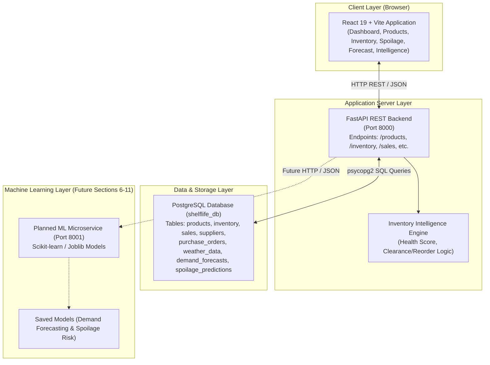

# ShelfLife System Architecture Document

## 1. System Overview

**ShelfLife** is an AI-powered perishable inventory management and retail analytics system designed for small retail stores, kirana shops, and neighbourhood supermarkets. The system aims to mitigate inventory loss and financial waste caused by premature expiration, overstocking, understocking, and lack of perishable-specific demand and spoilage intelligence.



---

## 2. Technology Stack

| Layer | Component | Version / Library | Role |
| :--- | :--- | :--- | :--- |
| **Frontend** | React | `^19.2.8` | Declarative UI rendering |
| **Frontend Build Tool** | Vite | `^8.2.0` | Fast local dev server & bundler |
| **Styling** | Vanilla CSS | Custom responsive styles in `App.css` | UI presentation & status badges |
| **Backend Framework** | FastAPI | `0.141.1` | High-performance asynchronous REST API |
| **ASGI Server** | Uvicorn | `0.52.4` | Application server running on Windows |
| **Database Connector** | psycopg2-binary | `2.9.12` | PostgreSQL adapter for Python |
| **Database** | PostgreSQL | `18.x` (`shelflife_db`) | Relational persistence for retail entities |
| **Data & ML (Prepared)** | pandas, NumPy, scikit-learn, joblib | `3.0.5`, `2.5.2`, `1.9.0`, `1.5.3` | Planned pipeline for demand forecasting & spoilage |

---

## 3. Directory Structure

```text
ShelfLife/
├── .env.example                     # Environment configuration template
├── .gitignore                       # Repository ignore rules (venv, node_modules, logs)
├── README.md                        # Master project readme
├── docs/                            # Project documentation
│   └── architecture/
│       ├── overview.md              # Project overview & foundation inspection
│       └── system-architecture.md   # Detailed architectural specification
├── backend/                         # FastAPI Application
│   ├── database.py                  # PostgreSQL connection provider
│   ├── main.py                      # FastAPI routes & business logic
│   ├── requirements.txt             # Backend Python dependencies
│   └── venv/                        # Python virtual environment (ignored in git)
├── frontend/                        # React + Vite Application
│   ├── index.html                   # Single-page application entry HTML
│   ├── package.json                 # Node dependencies and scripts
│   ├── vite.config.js               # Vite configuration
│   ├── public/                      # Static assets (favicons, SVG icons)
│   └── src/                         # React components & styles
│       ├── App.jsx                  # Main application component & navigation views
│       ├── App.css                  # Component styling and layout
│       ├── index.css                # Global styles
│       └── main.jsx                 # React root mount
└── ml/                              # Machine Learning models and training scripts (Section 6+)
```

---

## 4. Database Schema Summary

The current PostgreSQL database (`shelflife_db`) contains the following verified relational tables:

1. **`products`**: Catalog of items (`product_id`, `product_name`, `category`, `unit`, `purchase_price`, `selling_price`, `shelf_life_days`).
2. **`inventory`**: Batch-level inventory tracking (`inventory_id`, `product_id`, `batch_number`, `quantity`, `purchase_date`, `expiry_date`, `storage_temperature`).
3. **`sales`**: Point-of-sale records (`sale_id`, `product_id`, `quantity_sold`, `selling_price`, `sale_date`, `sale_time`).
4. **`suppliers`**: Vendor details (`supplier_id`, `supplier_name`, `contact_person`, `phone`, `email`, `average_delivery_days`, `minimum_order_quantity`).
5. **`purchase_orders`**: Restock tracking (`purchase_order_id`, `supplier_id`, `product_id`, `quantity_ordered`, `order_date`, `expected_delivery_date`, `status`, `unit_cost`).
6. **`weather_data`**: Environmental conditions (`weather_id`, `location`, `temperature`, `humidity`, `rainfall`, `weather_date`).
7. **`demand_forecasts`**: Forecast results table (`forecast_id`, `product_id`, `forecast_date`, `predicted_demand`, `model_name`).
8. **`spoilage_predictions`**: Spoilage risk table (`prediction_id`, `product_id`, `inventory_id`, `prediction_date`, `days_remaining`, `spoilage_probability`, `risk_level`, `model_name`).
9. **`analytics`**: Aggregated performance metrics (`analytics_id`, `product_id`, `total_sales`, `wastage_cost`, `stock_turnover`).
10. **`users`**: User authentication entity (reserved for future role-based access).

> [!NOTE]
> All current rows in `demand_forecasts` and `spoilage_predictions` are **Synthetic Demo Records** seeded for UI/API demonstration. No supervised model has been trained or deployed yet; actual ML training begins in Sections 6 & 7 upon dataset verification.

---

## 5. Machine Learning Direction & Honesty Protocol

To adhere to the project's strict academic and engineering standards:
- **No Synthetic Model Claims**: Although database records contain `model_name = 'Random Forest'`, this is classified as *Demo/Synthetic Seed Data*.
- **Rule Engine vs. ML Distinction**: The current inventory recommendation logic (`calculate_health_score`, `get_recommendation`) is explicitly a **deterministic heuristic rule engine**, not machine learning.
- **Dataset Traceability**: In upcoming sections, ML models will only be trained if genuine raw datasets are provided under `data/raw/`. Data splits, preprocessing pipelines, and evaluation metrics will be fully reproducible and saved using `joblib`.
