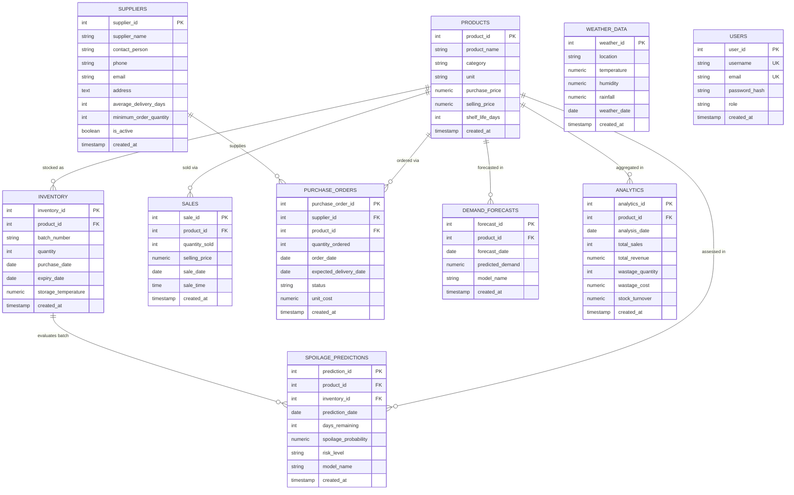

# ShelfLife Entity-Relationship (ER) Diagram

The following diagram represents the relational data model for **ShelfLife** deployed on PostgreSQL (`shelflife_db`).

---

## Key Cardinality Rationale

1. **`PRODUCTS` &rarr; `INVENTORY` (1 to Many):** A single perishable catalog product (e.g. "Milk") can have multiple batches (`MILK-B001`, `MILK-B002`) received on different days with distinct expiry dates and storage temperatures.
2. **`PRODUCTS` &rarr; `SALES` (1 to Many):** A product appears across multiple historical transaction events over time.
3. **`SUPPLIERS` &rarr; `PURCHASE_ORDERS` (1 to Many):** A supplier receives multiple replenishment purchase orders.
4. **`PRODUCTS` &rarr; `DEMAND_FORECASTS` (1 to Many):** Demand is projected across different dates for each product.
5. **`INVENTORY` &rarr; `SPOILAGE_PREDICTIONS` (1 to Many):** Spoilage risk can be tracked per batch over time as days remaining decreases toward expiry.
