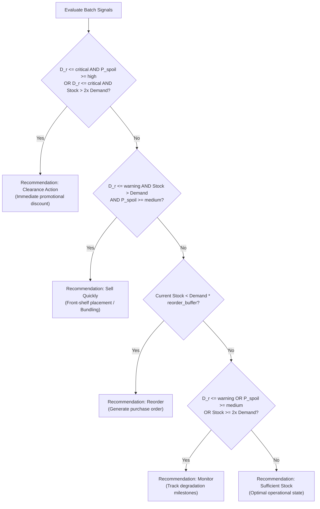

# ShelfLife Heuristic Rule Engine Specification

## 1. Design Philosophy & Academic Integrity Declaration

> [!IMPORTANT]
> **Explicit Declaration:** The Inventory Intelligence decision engine in this module is **NOT Machine Learning**. It is a deterministic, explainable, and fully configurable **heuristic business rule engine**. It combines multiple operational signals into actionable recommendations with human-readable natural language justifications.

---

## 2. Multi-Signal Input Vector

The rule engine processes 7 heterogeneous retail signals:
1. **Current Stock ($S_c$):** Quantity of on-hand perishable units in physical inventory.
2. **Predicted Demand ($D_p$):** Projected sales volume required over the planning horizon.
3. **Expiry Date ($T_{exp}$):** Date of batch degradation.
4. **Days Remaining ($D_r$):** $\max(T_{exp} - \text{today}, 0)$.
5. **Spoilage Probability ($P_{spoil}$):** Probability of batch spoilage ($0.0 - 1.0$).
6. **Storage Temperature ($T_{store}$):** Monitored storage temperature (°C) compared with category limits (e.g., $\le 5^\circ\text{C}$ for dairy).
7. **Ambient Environmental Data ($T_{amb}, H_{rel}$):** Local weather temperature and relative humidity accelerating microbial proliferation.

---

## 3. Zero-Magic-Numbers Principle (`RuleConfig`)

All thresholds, weights, and buffer multipliers are managed centrally in [`services/rule_config.py`](file:///C:/Users/SUNILKUMAR/OneDrive/Desktop/ShelfLife/backend/services/rule_config.py) and can be inspected or adjusted dynamically via `GET /inventory-intelligence/config` and `PUT /inventory-intelligence/config`.

| Parameter | Default | Boundary | Role in Decision Tree |
| :--- | :--- | :--- | :--- |
| `expiry_critical_days` | `2` days | $[0, 15]$ | Imminent expiry triggering Clearance Action |
| `expiry_warning_days` | `5` days | $[1, 30]$ | Shelf-life warning window triggering Sell Quickly / Monitor |
| `expiry_safe_days` | `10` days | $[3, 60]$ | Optimal shelf-life buffer receiving maximum expiry score |
| `spoilage_high_threshold` | `0.60` ($60\%$) | $[0.0, 1.0]$ | Boundary for High Spoilage Risk tier |
| `spoilage_medium_threshold`| `0.30` ($30\%$) | $[0.0, 1.0]$ | Boundary for Medium Spoilage Risk tier |
| `reorder_buffer_multiplier`| `1.0` | $[0.5, 3.0]$ | Buffer multiplier below which Reorder is triggered |
| `stock_excess_multiplier` | `2.0` | $[1.1, 5.0]$ | Threshold above which stock is classified as excessive |
| `weight_stock` | `0.30` ($30\%$) | $[0.0, 1.0]$ | Weight of stock coverage in Health Score |
| `weight_expiry` | `0.35` ($35\%$) | $[0.0, 1.0]$ | Weight of remaining shelf-life in Health Score |
| `weight_spoilage` | `0.35` ($35\%$) | $[0.0, 1.0]$ | Weight of spoilage resistance in Health Score |
| `dairy_max_temp` | `5.0` °C | - | Maximum safe storage temperature for cold-chain dairy |
| `ambient_high_temp` | `30.0` °C | - | Outdoor temperature threshold accelerating spoilage |
| `high_humidity_threshold` | `78.0` % | - | Relative humidity threshold promoting mold growth |

---

## 4. Normalized Health Score Calculation

The Inventory Health Score ($H \in [0, 100]$) provides an overall indicator of batch viability:

$$H = \max\left(0, \min\left(100, \text{round}\left(w_s \cdot S_{score} + w_e \cdot E_{score} + w_{sp} \cdot SP_{score} - \text{Penalty}_{env}\right)\right)\right)$$

### Component Scores:
1. **Stock Coverage Score ($S_{score}$):**
   - Stock ratio $R = S_c / D_p$
   - $R \ge 2.0 \implies 85$ (penalized slightly for excessive capital lockup)
   - $1.2 \le R < 2.0 \implies 100$ (optimal stock buffer)
   - $1.0 \le R < 1.2 \implies 80$
   - $0.75 \le R < 1.0 \implies 55$
   - $0.50 \le R < 0.75 \implies 35$
   - $R < 0.50 \implies 15$ (critical stockout hazard)
2. **Shelf-Life Score ($E_{score}$):**
   - $D_r = 0 \implies 0$
   - $D_r = 1 \implies 15$
   - $D_r \le \text{critical} \implies 35$
   - $D_r \le \text{warning} \implies 65$
   - $D_r \le \text{safe} \implies 85$
   - $D_r > \text{safe} \implies 100$
3. **Spoilage Resistance Score ($SP_{score}$):**
   - $SP_{score} = (1.0 - P_{spoil}) \times 100$
4. **Environmental Penalty ($\text{Penalty}_{env}$):**
   - For dairy/meat batches where $T_{store} > 5.0^\circ\text{C}$, $\text{Penalty} = \min((T_{store} - 5.0) \times 3.0, 15.0)$.

---

## 5. Recommendation Decision Hierarchy

---

## 6. Scenario Test Matrix

All 7 core scenarios are validated by automated unit tests in [`backend/tests/test_rules.py`](file:///C:/Users/SUNILKUMAR/OneDrive/Desktop/ShelfLife/backend/tests/test_rules.py):

| Scenario | Inputs ($S_c, D_p, D_r, P_{spoil}, \dots$) | Output Recommendation | Explanation Key Takeaway | Status |
| :--- | :--- | :--- | :--- | :--- |
| **1. Understocked** | $S_c=10, D_p=30, D_r=8, P=0.15$ | `Reorder` | Flags 20-unit shortfall; advises order | **Passed** |
| **2. Imminent Expiry**| $S_c=25, D_p=10, D_r=1, P=0.75$ | `Clearance Action` | 1 day left, 75% risk; immediate discount | **Passed** |
| **3. Surplus Near Warning**| $S_c=40, D_p=20, D_r=4, P=0.45$ | `Sell Quickly` | 20 surplus units, front-shelf priority | **Passed** |
| **4. Balanced Healthy**| $S_c=25, D_p=20, D_r=14, P=0.10$| `Sufficient Stock` | Score $\ge 75$ (Healthy), comfortable buffer | **Passed** |
| **5. Cold-Chain Breach**| $T_{store}=10^\circ\text{C}$ on Dairy | Penalty applied | Warns storage temp exceeds $5^\circ\text{C}$ limit | **Passed** |
| **6. Ambient Heat/Humidity**| $T_{amb}=34^\circ\text{C}, H=82\%$ | Environmental notice | Appends weather acceleration warning | **Passed** |
| **7. Config Threshold Shift**| Custom `RuleConfig` | Dynamic boundary shift | Proves zero magic numbers in engine | **Passed** |
